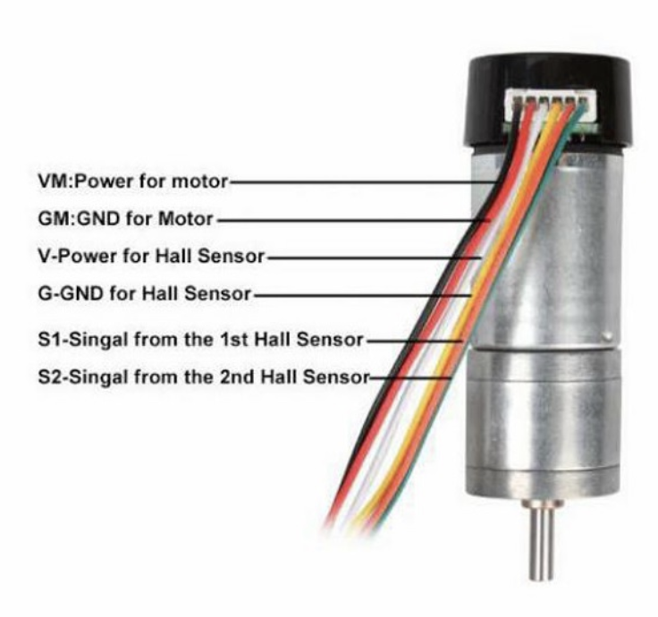

# Legacy Notebook Notes Summary

This file captures useful information recovered from an older notebook. It is intentionally cleaned up and reorganised. Old passwords from the notes are not repeated here; do not commit active credentials to this repo.

## 1. Previous project goals

Original high-level goals:

- Add Dupont connectors on motors and sensors.
- Detect hall effect sensors with Arduino, possibly using an oscilloscope for debugging.
- Arduino motor control with odometry, e.g. move forward one rotation.
- Figure out Arduino/ROS communication.
- Get robot moving.
- Get ROS-controlled movement.
- Publish wheel odometry.
- Run from battery power.
- Get lidar data.
- Run SLAM.

Progress recorded at the time:

- Moving robot: done.
- Arduino Nano obtained.
- Arduino, motor controller, and motors wired.
- Arduino code written to detect motor positions.
- ROS running on Raspberry Pi.
- ROS on laptop connected to Raspberry Pi.

Still outstanding in the old notes:

- Start ROS on both machines and share a topic reliably.
- Create ROS package broadcasting fake odometry.
- Send ROS messages to motor controller to drive robot.
- Publish wheel odometry messages in ROS.
- Battery power.
- Lidar data.
- SLAM.

## 2. Known hardware from old notes

### Raspberry Pi

- Raspberry Pi 4 Model B.
- 2 GB RAM.

### Chassis

- AliExpress link from old notes:
  - <https://www.aliexpress.com/item/32800078967.html>

### Lidar

- AliExpress link from old notes:
  - <https://www.aliexpress.com/item/4001253643974.html>
- Likely MB_1R2T or compatible factory-test lidar.
- See:
  - [`lidar-module-notes.md`](lidar-module-notes.md)
  - [`lidar-mb-1r2t-ros2-port.md`](lidar-mb-1r2t-ros2-port.md)

### Motors

Motor spec link from old notes:

- <https://gitnova.com/#/Robot/Engine/9vMotor/9vmotor>

Sample base-controller code referenced:

- <https://github.com/centauri-robotics/ck9/blob/master/arduino/base_controller_ros.ino>

Motor driver / power board reference:

- <https://www.instructables.com/Tutorial-for-Dual-Channel-DC-Motor-Driver-Board-PW/>

Hall effect wiring note:

- Old note says power and ground for hall effect may be the other way around: `5V to yellow and 0V to white`.
- Treat this as a warning, not confirmed fact. Verify with datasheet/meter before wiring.

Saved motor/hall wiring image:

- 

## 3. Lidar-specific recovered notes

Question from old notes:

> Who already launched lidar, what protocol is there, or can there be a ready-made software for it?

Recovered answer:

- Search for `MB_1R2T_LIDAR_Demo` on GitHub.
- Pins on the 8P JST-PH / 2.0 mm connector were described as:

```text
from left to right:
5V, Serial out, 158700 baud, x, GND, 0-5V rotation speed control, x, x, x
```

The phrase includes the baud rate in the pin list, so interpret carefully. It likely means serial out uses 158700 baud.

Community links:

- Python demo: <https://github.com/stdlogicvector/MB_1R2T_LIDAR_Demo>
- Reverse-engineering repo: <https://github.com/Vidicon/Radar_MB_1R2T>
- ROS 1 driver: <https://github.com/Vidicon/mb_1r2t_ros>
- 3D model: <https://github.com/simonllopez/radar_mb_1r2t-3D-model>

The `mb_1r2t_ros` repository is ROS 1, not ROS 2. It is nevertheless very useful as source material for a ROS 2 port.

## 4. Software notes from old project

Old notes mention ROS 1 commands such as:

```bash
roscore
export ROS_MASTER_URI=http://raspberry-pi-device:11311
```

These are **ROS 1 concepts** and should not be used for the new ROS 2 setup.

For ROS 2:

- There is no `roscore`.
- Use `ROS_DOMAIN_ID` to isolate discovery.
- Use DDS discovery across Wi-Fi, or a configured bridge if needed.

Old laptop environment:

- Ubuntu Server 22 in UTM/QEMU.
- LXQt + SDDM installed for GUI.
- ROS 2 Humble installation docs followed.

New recommendation remains:

- Robot: Ubuntu Server 24.04 arm64 + ROS 2 Jazzy if starting fresh.
- Fallback: Ubuntu 22.04 + ROS 2 Humble if driver support blocks Jazzy.

## 5. Odometry notes

Old notes suggested:

- `ros-humble-ros2-controllers`
- Nav2 getting started docs.
- `ros2_control_demos` differential-drive demo.
- A Gazebo tracked vehicle example.

This aligns with the current architecture recommendation:

- Use `ros2_control` + `diff_drive_controller` for the base where practical.
- Use Arduino/microcontroller or motor controller for low-level encoder counting and motor control.
- Publish standard odometry and TF for SLAM/Nav2.

## 6. Implications for the new plan

The old notes make the path clearer:

1. Raspberry Pi hardware is known: Pi 4 Model B, 2 GB.
2. Lidar is probably MB_1R2T and has existing reverse-engineered protocol/code.
3. Motors have hall sensors and were previously read by Arduino.
4. An Arduino Nano was previously used and may still be the fastest route for low-level motor/encoder control.
5. ROS 2 remains the right direction, but any ROS 1 code should be ported rather than used directly.
