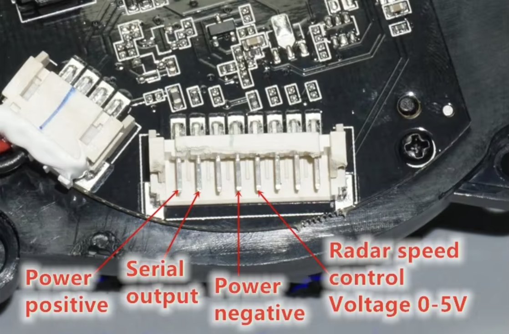
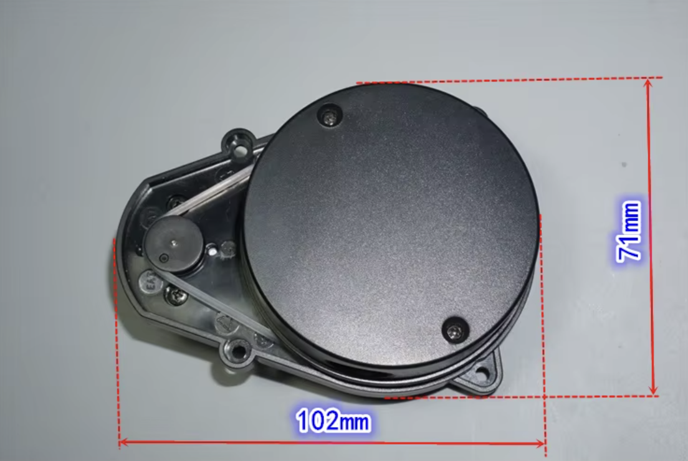

# Lidar Module Notes and Investigation Plan

## 1. Summary

The lidar module is not yet confirmed as a normal retail YDLIDAR model. The seller description says it is a **factory test product** and explicitly says the data format is unknown. This makes it a higher-risk part than a known YDLIDAR X2/X4/G-series unit, but it may still be usable.

Current evidence:

- 360-degree rotating scanning lidar.
- Runs from 5 V.
- Serial port outputs data directly after power-on.
- Main MCU: `STM32F302C8T6`.
- Rotating head uses wireless power and infrared signal transfer rather than a slip ring.
- External speed control pin exists; seller says it does not need to be connected.
- Weight about 170 g.
- 8-pin, 2.0 mm pitch connector.
- Product dimensions shown in screenshot: roughly 102 mm x 71 mm.
- Connector screenshot labels only four useful pins:
  - power positive
  - serial output
  - power negative
  - radar speed control, 0-5 V

Images copied into this repo:

- 
- 

## 2. Important risk assessment

This lidar should be treated as an **unknown serial lidar**, not assumed to be supported by ROS yet.

There are three possible outcomes:

1. **It speaks a standard YDLIDAR protocol.**
   - Best case.
   - We can use YDLIDAR SDK plus `ydlidar_ros2_driver`.

2. **It speaks a simple non-YDLIDAR serial protocol that can be reverse engineered.**
   - Still usable.
   - We write a small parser and publish `sensor_msgs/LaserScan` ourselves.

3. **It uses an undocumented or incomplete factory/test stream.**
   - It may be time-consuming or impractical.
   - In that case, buying a known ROS 2-supported lidar may be cheaper than reverse engineering.

Do not let this block the whole robot project. If this module takes more than a couple of sessions to decode, consider replacing it with a known supported 2D lidar and returning to this one as a side project.

## 3. Relevant YDLIDAR GitHub resources

The official YDLIDAR organisation is:

- <https://github.com/YDLIDAR/>

Useful repositories identified:

| Repository | Use |
|---|---|
| <https://github.com/YDLIDAR/ydlidar_ros2_driver> | Current ROS 2 driver package. README says to use the `humble` branch for Humble/Jazzy/etc. |
| <https://github.com/YDLIDAR/YDLidar-SDK> | Current SDK with protocol docs and model dataset. |
| <https://github.com/YDLIDAR/ydlidar_ros2> | Older ROS 2 package and model dataset; may be useful for examples. |
| <https://github.com/YDLIDAR/ydlidar_tutorials> | SDK usage examples. |
| <https://github.com/YDLIDAR/SerialTools> | Vendor serial tooling. |
| <https://github.com/YDLIDAR/LIDAR_ros2_driver> and <https://github.com/YDLIDAR/LIDAR_SDK> | Newer/different YDLIDAR lidar family, apparently network-oriented in README. Only relevant if this module matches that family. |

The old local package at `lidar-resources/ydlidar_ros_driver-master` is ROS 1/catkin. It should not be used directly in the ROS 2 robot workspace.

## 4. Known YDLIDAR protocol fingerprints

From the local `YDLidar-SDK` protocol docs:

- Data packet header is `0x55AA`, sent little-endian as bytes:

```text
AA 55
```

- Packet fields for typical scan data:

```text
PH(2B) CT(1B) LSN(1B) FSA(2B) LSA(2B) CS(2B) Samples...
```

- Some command/response sync bytes use:

```text
A5 5A
```

When capturing raw serial output, seeing frequent `AA 55` packet headers would be strong evidence that the module is YDLIDAR-compatible or YDLIDAR-like.

Known YDLIDAR baud rates include:

- 115200
- 128000
- 153600
- 230400
- 512000
- 8000 for some T-series units

The seller description only says serial data exists, not the baud rate.

## 5. Electrical connection cautions

The screenshot labels `Power positive`, `Serial output`, `Power negative`, and `Radar speed control Voltage 0-5V`.

Before connecting to Raspberry Pi GPIO/UART:

1. Power the lidar from a stable 5 V supply with enough current.
2. Use common ground between lidar and USB-UART adapter/Pi.
3. Measure the serial output voltage level with a multimeter or oscilloscope/logic analyser.
4. Assume the serial output may be **5 V TTL** until proven otherwise.
5. Raspberry Pi GPIO is **not 5 V tolerant**.
6. Prefer a USB-to-TTL serial adapter that tolerates 5 V input, or use a level shifter/voltage divider.
7. Do not connect the speed-control pin initially unless required.
8. If using speed control later, confirm whether it expects analogue voltage or PWM. The seller wording says `Voltage 0-5V`, but YDLIDAR docs often refer to PWM speed control on some models.

Recommended first test connection:

```text
Lidar 5V+      -> external 5 V supply +
Lidar GND      -> external 5 V supply - and USB-UART GND
Lidar serial   -> USB-UART RX through appropriate level shifting if needed
Speed control  -> not connected initially
```

Because the seller says the serial port outputs data directly, TX from the host may not be required for first capture.

## 6. Investigation procedure

### Step 1: Preserve evidence

- Keep the seller description in this doc.
- Keep the pinout and dimensions screenshots under `docs/assets/`.
- Photograph the actual module, cable, connector, and PCB markings.

### Step 2: Identify connector pins physically

The screenshot is useful, but before powering:

- Confirm orientation of connector relative to the screenshot.
- Use continuity tests if possible to identify ground.
- Look for silkscreen labels.
- Mark pin 1 on the cable.

### Step 3: Power-only test

- Connect only 5 V and ground.
- Current-limit the bench supply if available.
- Confirm the motor spins.
- Measure current draw.
- Listen/observe whether speed is stable.

Record:

- Startup current:
- Steady current:
- Approx rotation rate if visible:
- Any LEDs:

### Step 4: Raw serial capture

Use a USB-UART adapter and capture bytes at likely baud rates.

Candidate baud rates:

```text
8000, 9600, 19200, 38400, 57600, 115200, 128000, 153600, 230400, 256000, 460800, 512000, 921600
```

Use [`../scripts/lidar_capture_serial.py`](../scripts/lidar_capture_serial.py) to capture raw bytes.

Example:

```bash
python3 -m pip install pyserial
python3 scripts/lidar_capture_serial.py --port /dev/ttyUSB0 --baud 230400 --seconds 5 --out captures/lidar_230400.bin
xxd -g 1 -l 256 captures/lidar_230400.bin
```

Signs of the correct baud rate:

- Data is continuous and repeatable.
- Repeated headers such as `AA 55` appear if YDLIDAR-like.
- Packet lengths/checksums look plausible.
- Changing objects in front of the lidar changes the stream in a structured way.

Signs of the wrong baud rate:

- Nearly all bytes are `00`, `FF`, or random-looking without stable headers.
- No repeatable patterns.
- Framing errors from adapter/logic analyser.

### Step 5: Try YDLIDAR SDK/driver only after raw capture

If raw capture shows YDLIDAR-like packets, try the vendor SDK and ROS 2 driver.

Suggested source install location later:

```text
ros2_ws/src/vendor_drivers/ydlidar_ros2_driver
ros2_ws/src/vendor_drivers/YDLidar-SDK
```

The current ROS 2 driver README says:

```bash
git clone -b humble https://github.com/YDLIDAR/ydlidar_ros2_driver.git
```

for Humble/Jazzy-era ROS 2.

Try likely parameter sets from the YDLIDAR dataset:

| Candidate family | Baud | Notes |
|---|---:|---|
| X2/X2L/X2N/X3 | 115200 | Single-channel, 5 V, PWM speed control; cheap modules often resemble this class. |
| X4/X4 Pro | 128000 | 5 V, PWM speed control. |
| G4/G5/G2/F4Pro | 230400 | Higher sample-rate units. |
| G6/G7/TG | 512000 | Higher-end units. |

### Step 6: If SDK fails, reverse engineer the stream

If data is readable but not accepted by YDLIDAR SDK:

1. Capture 10-30 seconds of data at the correct baud.
2. Capture with a wall or box at a known distance.
3. Capture with an object moved around the scanner.
4. Look for packet headers, checksums, angle counters, distance values.
5. Write a standalone parser that outputs angle/distance pairs.
6. Wrap it in a ROS 2 node publishing `sensor_msgs/LaserScan`.

A custom driver only needs to publish `/scan`; the rest of the SLAM stack does not care whether the data came from a vendor package or our own parser.

## 7. Decision gate

Use this rule to avoid spending unlimited time on the lidar:

- If no stable serial stream can be captured in one focused hardware session, pause and reassess wiring/voltage/baud.
- If a stable stream exists but no protocol is identified after one or two focused software sessions, consider buying a known supported lidar for the main robot build.
- Keep this module as a reverse-engineering side quest if needed.

Known-good replacement criteria:

- Explicit ROS 2 driver support.
- USB connection or well-documented UART.
- Published baud rate and packet format.
- 2D `sensor_msgs/LaserScan` examples available.
- Sufficient range for indoor SLAM, ideally 6-12 m or more.

## 8. Seller description copied for reference

> Factory test product, sold cheaply, no promise that it works. 360-degree rotating scanning lidar. Main control chip STM32F302C8T6. Radar rotation uses wireless power supply plus infrared on-beam signal transmission to avoid slip-ring wear. Works directly after powering on 5 V. Serial port outputs data directly. Supports external radar speed control function pins; speed control does not need to be connected. Currently the data format is unknown. Weight about 170 g. Terminal interface is 8P 2.0 pitch. Generally only 3 terminals are sufficient. A 4P cable is included.
