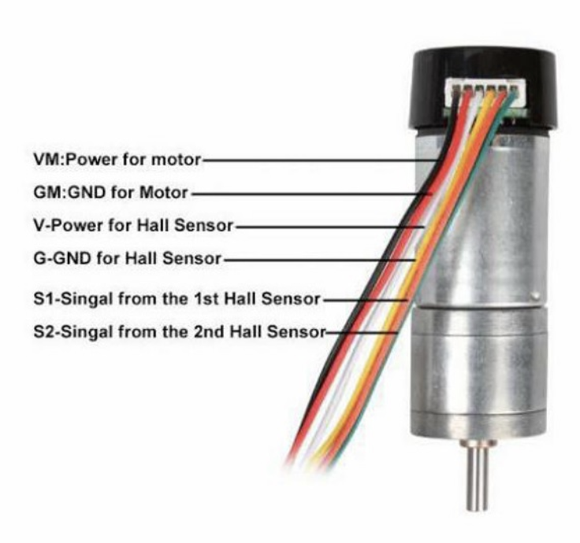

# Motor Control Plan: Raspberry Pi + Arduino Nano + HW-354

## 1. Current known hardware

Newly confirmed:

- Onboard computer: Raspberry Pi 4 Model B, 2 GB RAM.
- Low-level I/O controller available: Arduino Nano clone with CH340C USB-serial and mini USB.
- Motor driver: HW-354 dual motor controller based on MX1508.
- Motors: two geared DC motors with hall-effect encoder outputs, based on old notes/images.
- A spare RS232-TTL adapter is available, likely bought for lidar serial capture or microcontroller/serial debugging.

## 2. Recommended architecture

Use the Arduino Nano for low-level motor/encoder I/O, and use the Raspberry Pi for ROS 2, SLAM, navigation, logging, and networking.

```text
ROS 2 on Raspberry Pi
  |
  | USB serial
  v
Arduino Nano firmware
  |
  | PWM / direction pins
  v
HW-354 dual motor controller
  |
  v
Left/right DC motors
  |
  | Hall sensor encoder signals
  v
Arduino Nano interrupt pins / digital pins
```

This architecture has real merits:

- Encoder edge counting is timing-sensitive; Arduino interrupt handling is more predictable than Linux userspace GPIO.
- PWM generation is simple and stable on Arduino.
- The Raspberry Pi stays focused on ROS 2, lidar, SLAM, and high-level control.
- It reduces risk of damaging the Pi GPIO while experimenting with motor electronics.
- It can be tested independently from ROS: send serial commands, watch encoder counts, then add ROS later.

## 3. HW-354 caution

The HW-354 board is confirmed as an MX1508 dual motor controller.

Known pins:

| Pin | Meaning |
|---|---|
| `VCC` | Motor power input, usually 2 V to 10 V |
| `GND` | Ground |
| `INA`, `INB` | Motor A control pins |
| `INC`, `IND` | Motor B control pins |
| `OUT1`, `OUT2` | Motor A outputs |
| `OUT3`, `OUT4` | Motor B outputs |

Important: do **not** feed 12 V directly to this board if its VCC rating is 2-10 V. Start with 6-9 V current-limited bench supply.

A concrete wiring and power plan is in [`electrical-wiring-and-power-plan.md`](electrical-wiring-and-power-plan.md).

## 4. Control model

For a differential/skid-steer tracked robot, the Pi should send desired left and right wheel/track velocities to the Arduino. The Arduino should:

1. Count encoder ticks.
2. Estimate current left/right velocity.
3. Run a simple PID loop per motor.
4. Output PWM/direction to the motor driver.
5. Report encoder counts and/or measured velocities back to the Pi.
6. Stop motors if it has not received a command recently.

The Pi should:

1. Receive `/cmd_vel` from teleop/Nav2.
2. Convert `/cmd_vel` into left/right velocity setpoints, or let `diff_drive_controller` do this.
3. Send setpoints to Arduino.
4. Receive encoder counts from Arduino.
5. Publish odometry and `odom -> base_link` TF.

## 5. Two viable ROS 2 integration options

### Option A: Simple ROS 2 base node, fastest first version

Create a Python or C++ ROS 2 node on the Pi:

```text
slam_robot_base_node
```

Responsibilities:

- Subscribe to `/cmd_vel`.
- Convert `Twist` to left/right target speeds.
- Send serial command to Arduino.
- Read encoder reports from Arduino.
- Compute odometry.
- Publish `/odom` and TF.

Pros:

- Fastest to implement.
- Easy to debug.
- Minimal ROS 2 control framework complexity.

Cons:

- Less standard than `ros2_control`.
- Later Nav2 integration is still fine, but controller tuning/config is custom.

### Option B: `ros2_control` hardware interface, cleaner long-term

Create a `ros2_control` hardware interface that talks to the Arduino over serial. Then use:

- `diff_drive_controller`
- `joint_state_broadcaster`

Pros:

- More standard ROS 2 architecture.
- `diff_drive_controller` handles `/cmd_vel`, odometry, limits, and TF.
- Cleaner long-term maintainability.

Cons:

- More initial code and configuration.
- Harder to debug if serial protocol and ROS 2 control are both new.

### Recommendation

Start with **Option A** for bringup and odometry calibration. Keep the serial protocol clean enough that it can later be reused by a `ros2_control` hardware interface.

## 6. Proposed Arduino serial protocol

Keep it line-based ASCII at first. It is easy to inspect with `screen`, `minicom`, or the Arduino serial monitor.

### Pi to Arduino

Set target velocity in encoder ticks per second:

```text
V <left_ticks_per_sec> <right_ticks_per_sec>\n
```

Examples:

```text
V 120 120
V -80 80
V 0 0
```

Stop immediately:

```text
S\n
```

Request status:

```text
?\n
```

Set PID gains, optional later:

```text
P <kp> <ki> <kd>\n
```

### Arduino to Pi

Periodic encoder/status report, e.g. 20-50 Hz:

```text
E <millis> <left_count> <right_count> <left_ticks_per_sec> <right_ticks_per_sec> <left_pwm> <right_pwm>\n
```

Example:

```text
E 123456 12033 11988 105 103 87 85
```

Fault report:

```text
F <code> <message>\n
```

### Why target ticks/sec first?

It avoids needing exact wheel radius in the Arduino firmware. Physical calibration can live on the Pi/ROS side. The Arduino just regulates encoder tick rate.

## 7. Arduino firmware responsibilities

Minimum firmware features:

- Configure motor driver pins.
- Configure encoder input pins.
- Count encoder ticks.
- Parse serial commands.
- Run control loop at a fixed interval, e.g. 50-100 Hz.
- Apply command timeout, e.g. stop after 250-500 ms without a valid command.
- Limit maximum PWM.
- Report status periodically.

Recommended safety behaviour:

- Motors off on boot until command received.
- Motors off on serial timeout.
- Motors off if command parsing fails badly.
- Motors off if reset button pressed or firmware crashes/reboots.

## 8. Encoder pin caveat on Arduino Nano

Classic Arduino Nano/ATmega328P has two external interrupt pins:

- D2 = INT0
- D3 = INT1

If each motor has quadrature A/B channels, full quadrature decoding for two motors can be done, but may require pin-change interrupts or a library. Simpler first options:

1. Use interrupt on one channel per motor, preferably a single edge such as `RISING`, and read the second channel for direction.
2. Use pin-change interrupts for all four channels.
3. Use a quadrature encoder library that supports Nano pin-change interrupts.

For low-speed tracked robot testing, option 1 may be adequate. The discovered existing-board pinout appears to use this approach: Motor A `S2` on D2/INT0 with `S1` on D4, and Motor B `S2` on D3/INT1 with `S1` on D7. For robust odometry, option 2 or a better microcontroller may be preferable.

If encoder rate is too high for the Nano or firmware becomes messy, consider an RP2040, Teensy, or a motor controller with built-in encoder support later.

## 9. Motor wiring notes to verify

From old notes:

- The hall-effect sensor power/ground may be reversed compared with the product image.
- Old note says: `5V to yellow and 0V to white`.

Treat this as a warning, not a truth. Before powering sensors:

- Confirm with motor datasheet if possible.
- Use a multimeter/bench supply/current limit.
- Check signal levels from hall sensors.
- Confirm Arduino input pins see 0-5 V, not motor voltage.

The old motor wiring image is saved here:

- 

## 10. RS232-TTL adapter note

The spare adapter uses a MAX3232 chip.

Important:

- MAX3232 is an RS-232 level converter, not a USB-to-TTL serial adapter by itself.
- Its RS-232 side uses true RS-232 signalling and must not be connected to the lidar TTL serial output or Raspberry Pi GPIO.
- For lidar capture you likely need a USB-to-TTL UART adapter, or a safe TTL-side connection into another serial device.
- The Arduino Nano's CH340C already provides USB serial for Arduino-to-Pi communication, so the MAX3232 is probably not needed for the base controller.

## 11. Bringup order

1. Photograph HW-354 board, motor connectors, Arduino wiring, and labels.
2. Identify HW-354 control pins.
3. Write/test Arduino firmware with motors lifted off the ground.
4. Confirm encoder counts for each motor.
5. Tune simple speed PID on Arduino using serial commands only.
6. Create ROS 2 base node on Pi.
7. Teleop `/cmd_vel` -> Pi base node -> Arduino -> motors.
8. Publish `/odom`.
9. Calibrate odometry.
10. Integrate lidar and SLAM.

## 12. Open details needed

- Confirm Arduino Nano MCU/logic voltage, though CH340C clone strongly suggests classic 5 V Nano.
- Motor supply voltage and battery plan.
- Encoder ticks per revolution.
- Confirm hall sensor VCC voltage, likely 5 V.
- Whether existing old Arduino code can be recovered from anywhere.
